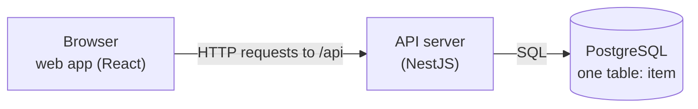
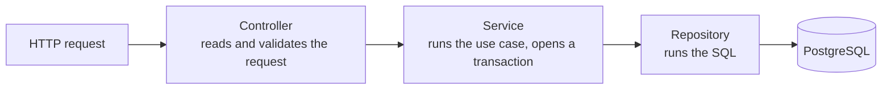

# treefs

treefs stores the structure of a file tree: folders, files and their names. It does not store file contents. A
user can:

- create folders and files, at the top level or inside a folder
- open a folder and page through its contents
- search for an item by its exact name, in one folder or in every folder
- get suggestions while typing: the 10 newest items whose names start with the typed text
- delete a file, or a folder together with everything inside it

The project is a time-boxed take-home assignment. Every feature above is built. Work that would only add more proof
or polish was left out; each omission is listed in [Trade-offs and what I skipped](#trade-offs-and-what-i-skipped).

## Contents

1. [How the project is organised](#how-the-project-is-organised)
2. [Running the app](#running-the-app)
3. [Debugging the API](#debugging-the-api)
4. [Checks and tests](#checks-and-tests)
5. [The HTTP API](#the-http-api)
6. [How the data is stored](#how-the-data-is-stored)
7. [How fast it is](#how-fast-it-is)
8. [Trade-offs and what I skipped](#trade-offs-and-what-i-skipped)
9. [Growing beyond one database](#growing-beyond-one-database)
10. [How AI was used](#how-ai-was-used)

## How the project is organised

The repository holds two programs that talk over HTTP, and one database:



- **The web app** (`web/`) is a single-page application built with Vite and React. TanStack Query fetches data from
  the API and caches it in the browser.
- **The API** (`backend/apps/api/`) is a NestJS server. Every route lives under `/api`.
- **PostgreSQL** is the only place where data is kept. The API keeps nothing in memory between requests.

The code is a pnpm workspace with two packages:

| Folder                  | What it contains                                                                   |
| ----------------------- | ---------------------------------------------------------------------------------- |
| `backend/apps/api`      | the API server; the `items` module holds everything about files and folders        |
| `backend/libs/common`   | code shared inside the backend: error classes, paging helpers, shared limits       |
| `backend/libs/config`   | reads and validates environment variables                                          |
| `backend/libs/database` | the database table definition (entity), migrations and the transaction helper      |
| `backend/libs/dto`      | the shape of an item as the API returns it                                         |
| `web`                   | the web app; its TypeScript types are generated from the API's types at build time |
| repository root         | settings that cover both packages: formatting, linting, git hooks, Docker Compose  |

Inside the API, a request passes through three layers. Each layer has one job:



The controller also shapes the response: it converts the service's result into the public response format and
checks the result against a schema before sending it.

## Running the app

### What you need

- Node.js 24.2 or newer
- pnpm, which Node ships through corepack (`corepack enable` turns it on)
- Docker, which runs PostgreSQL

### Option 1: everything in Docker

```sh
docker compose up --build
```

This builds the API and the web app, starts PostgreSQL, creates the database tables and serves the app on
http://localhost:3000.

### Option 2: run the code directly (for development)

```sh
corepack enable
pnpm install
cp backend/apps/api/.env.example backend/apps/api/.env
cp backend/apps/api/.env.test.example backend/apps/api/.env.test
pnpm services      # starts PostgreSQL in Docker and waits until it accepts connections
pnpm db:migrate    # creates the tables
pnpm start:dev     # starts the API on http://localhost:3001 and restarts it when a file changes
pnpm dev:web       # starts the web app on http://localhost:3000
```

Open http://localhost:3000. The web development server forwards every request that starts with `/api` to the API
on port 3001, so the browser only ever talks to port 3000.

**Configuration.** The API reads its settings (database host, port, password and so on) from
`backend/apps/api/.env`. The code has no default values: if a setting is missing or invalid, the API stops at
startup and names the setting. The integration tests read `backend/apps/api/.env.test`, which points at a separate
database called `treefs_test`.

**Inside a dev container.** PostgreSQL runs on your computer, outside the container. Inside the container,
`localhost` means the container itself, so the API cannot find the database there. Set
`DB_HOST=host.docker.internal` in both `.env` files; that name points from the container back to your computer.

**Production build.** `pnpm build` compiles the API into `backend/dist/apps/api/main.js`, which you start with
`node`. `pnpm --filter web build` writes the web app's static files to `web/dist`.

## Debugging the API

Debugging means pausing the running API at a line of code (a breakpoint) and inspecting its variables. It takes two
steps: start the API in a mode that accepts a debugger, then connect VS Code to it.

1. In a terminal, run:

   ```sh
   pnpm start:debug
   ```

   This is the same as `pnpm start:dev`, with one addition: Node opens a debugging port, 9229. The terminal prints
   `Debugger listening on ws://127.0.0.1:9229/...` when it is ready.

2. In VS Code, open the **Run and Debug** view, choose **Attach to API** and press the start button. VS Code connects
   to port 9229.

3. Set a breakpoint, for example in `backend/apps/api/src/items/services/items.service.ts`, and send a request
   from the web app. The API stops at the breakpoint.

If you work in a dev container, run step 1 in a terminal inside the container. VS Code runs inside the same
container, so it reaches port 9229 directly.

The second configuration, **Debug integration tests**, starts the integration tests with the debugger attached.

## Checks and tests

| Command         | What it does                                                                                                       |
| --------------- | ------------------------------------------------------------------------------------------------------------------ |
| `pnpm check`    | runs everything below plus formatting (Prettier), linting (ESLint), type checking and unused-code detection (knip) |
| `pnpm test`     | unit tests (`*.spec.ts`): fast tests of functions that do not touch the database                                   |
| `pnpm test:e2e` | integration tests (`*.e2e-spec.ts`): start the real API and send it HTTP requests; needs PostgreSQL running        |

Most tests are integration tests. They talk to a real PostgreSQL database instead of a fake one, because many
rules live in the database itself (for example, "two items in one folder cannot have the same name"). A fake
database would not enforce those rules, so a test against it could pass while the real system fails.

The integration tests cover:

- every status code the API can return
- 50 requests creating the same name at the same moment: exactly one succeeds
- creating an item inside a folder while that folder is being deleted: no item is left without a parent
- several requests deleting the same folder at once
- paging through long lists
- folders nested 64 levels deep
- unusual names: `%`, `_`, quotes, SQL fragments, right-to-left control characters

Each test suite deletes the rows it created when it finishes. As a safety measure, the clean-up code refuses to run
unless the database name ends in `_test`, so a wrong setting cannot wipe the development data.

Git hooks run automatically: formatting and linting before each commit, a commit-message check, and `pnpm check`
before each push. The web app has no automated tests; it was tested by hand.

## The HTTP API

All routes start with `/api/v1/items`. An **item** is a file or a folder:

```json
{
  "id": "0193b2b0-...",
  "type": "file",
  "name": "report.pdf",
  "parentId": "0193b2a8-...",
  "path": "/Projects/2026/report.pdf",
  "createdAt": "2026-11-10T09:00:00.000Z"
}
```

`parentId` is `null` for an item at the top level.

| Request                                                | What it does                                         | Success                               |
| ------------------------------------------------------ | ---------------------------------------------------- | ------------------------------------- |
| `POST /api/v1/items` with `{type, name, parentId}`     | creates a file or folder                             | 201 Created, with a `Location` header |
| `GET /api/v1/items/{id}`                               | returns one item and the folders above it            | 200 OK                                |
| `GET /api/v1/items?parentId={id}` (or `parentId=root`) | lists a folder's contents, sorted by name            | 200 OK, `{items, nextCursor}`         |
| `GET /api/v1/items?q={text}&match=exact`               | finds items with exactly this name                   | 200 OK, `{items, nextCursor}`         |
| `GET /api/v1/items?q={text}&match=prefix`              | finds items whose name starts with the text          | 200 OK, `{items, nextCursor}`         |
| `DELETE /api/v1/items/{id}`                            | deletes the item and, for a folder, all its contents | 204 No Content, empty body            |

Optional query parameters for the list and search routes:

- `type=file` or `type=folder` returns only that kind of item.
- `parentId` on a search limits it to the direct children of one folder. Without it, the search covers every folder.
- `limit` sets the page size.
- `cursor` fetches the next page. Every list response contains `nextCursor`. Send it back as `cursor` to get the
  following page; when `nextCursor` is `null`, there are no more pages.

Prefix search returns the newest items first and 10 items by default. An empty `q` returns the 10 newest items of
all, which the web app shows when the search box gets focus.

**Errors.** Every error response has the same shape:

```json
{
  "code": "conflict.nameTaken",
  "message": "An item named \"report.pdf\" already exists in this folder",
  "statusCode": 409,
  "correlationId": "2a02b660-9922-409e-9a66-5813bd6ac20a"
}
```

| Status | Meaning                                                                    |
| ------ | -------------------------------------------------------------------------- |
| 400    | the request is invalid, for example an empty name or a name containing `/` |
| 404    | the item or the parent folder does not exist                               |
| 409    | the folder already contains an item with this name                         |
| 422    | the parent is a file, or the parent folder is already 64 levels deep       |

The `correlationId` is also sent in the `x-request-id` response header. It identifies the request in the server
logs.

## How the data is stored

All items live in one table:

| Column      | Meaning                                                       |
| ----------- | ------------------------------------------------------------- |
| `id`        | unique identifier (a UUID version 7, explained below)         |
| `type`      | `file` or `folder`                                            |
| `parentId`  | the `id` of the containing folder, or empty for the top level |
| `name`      | the name as the user typed it                                 |
| `nameKey`   | the name converted to a comparison form (explained below)     |
| `depth`     | how many folders are above the item (0 at the top level)      |
| `createdAt` | when the item was created                                     |

Each row points to its parent. This layout is called an **adjacency list**. It makes creating an item a single
insert, and moving an item later would change only one row.

### The database enforces the rules

Rules such as "names in one folder are unique" are written into the table itself, as constraints and indexes.
The API does not check first and then insert, because two requests could both pass the check at the same moment
and both insert. Instead, the API inserts directly. If the insert breaks a rule, PostgreSQL rejects it with an error
code, and the API turns that code into the matching HTTP status (409, 404 and so on).

The rules are:

- **Unique names per folder, ignoring case.** `Report.pdf` and `REPORT.PDF` count as the same name. So do two
  spellings of `café` that look identical but are stored as different Unicode characters. The `nameKey` column holds
  the name in lower case and in one standard Unicode form (NFC), and a unique index on `(parentId, nameKey)` allows
  each key only once per folder. The top level counts as one folder too.
- **A parent must be a folder.** The service checks this inside the same transaction as the insert.
- **Names are at most 255 bytes**, and certain characters are refused: `/`, `\`, control characters and
  right-to-left override characters.
- **Folders are at most 64 levels deep.** A folder at level 64 can exist, but nothing can be created inside it.
- **Deleting a folder deletes everything inside it.** The table uses `ON DELETE CASCADE`: deleting one row makes
  PostgreSQL delete all rows that point to it, then the rows that point to those, and so on. The whole delete is a
  single SQL statement, so it either removes everything or nothing.

### Indexes keep reads fast

An **index** is a sorted copy of some columns that lets the database find rows without reading the whole table,
like the index at the back of a book. Every read in treefs uses an index and asks for a fixed number of rows, so its
cost depends on the page size, not on how many items exist.

- **Listing a folder** uses the index on `(parentId, nameKey)`: the contents of one folder sit next to each other,
  already sorted by name.
- **Searching by name** uses an index on `(nameKey, id)`: equal names, and names with the same beginning, sit next to
  each other.
- **Newest first** uses the primary key. treefs uses **UUID version 7** identifiers, which start with a timestamp, so
  sorting by `id` also sorts by creation time.

**Paging** uses a cursor instead of a page number. A cursor remembers the last item of the current page, and the
next page starts right after it. With page numbers ("skip 5,000 rows, take 50") the database would read and throw
away 5,000 rows first; with a cursor it jumps straight to the right place in the index.

**Prefix search** asks for a range of keys ("from `rep` up to just before `req`") instead of SQL's `LIKE 'rep%'`.
This uses the index directly, and characters such as `%` or `_` typed by the user have no special meaning.

**Paths** such as `/Projects/2026/report.pdf` are not stored. Each time a page of items is returned, one SQL query
walks up the parent links and builds the paths. Stored paths could become wrong after a move; computed paths
cannot.

### Schema changes

The table is described in code as a TypeORM entity. Migrations, the scripts that change the database structure,
are generated from that entity with `pnpm --filter backend migration:generate` and applied with `pnpm db:migrate`.
The API never changes the database structure on its own when it starts.

## How fast it is

I filled a local database with about 2.1 million items:

- 200,000 folders, each holding a `README.md` and several other files
- one folder with 100,000 items
- a chain of folders 64 levels deep
- 2,000 names that are 251 bytes long

Response times of the API, measured with the data already in memory:

| Request                                                              | Time          |
| -------------------------------------------------------------------- | ------------- |
| list one page of a folder (also deep inside the 100,000-item folder) | 4 to 7 ms     |
| get an item 64 levels deep, with all the folders above it            | 4 ms          |
| find an exact name inside one folder                                 | 4 ms          |
| find `README.md` in every folder (200,000 matches), first page       | 56 ms         |
| suggestions for `rep`, files only                                    | 16 to 22 ms   |
| the 10 newest items                                                  | 6 ms          |
| suggestions for a prefix whose matches are all old (`area`, `a`)     | 270 to 360 ms |

The last row is the one slow case. The next section explains it. The script that generated the data was a
throw-away script and is not part of the repository.

## Trade-offs and what I skipped

**Slow suggestions for some prefixes.** Suggestions are sorted newest first. The database has one index sorted by
name and another sorted by creation time, but none sorted by both. For a short prefix, PostgreSQL walks through the
items from newest to oldest and checks each name until it has found 10 matches. When the matching items are all
old, it has to check almost every newer item first. With 2.1 million items, that took 270 to 360 ms for prefixes
such as `area`. Ways to fix it: look only at the first few hundred matches by name and sort those by date, or move
search to a dedicated search engine.

**Load tests.** I measured single requests (previous section), but did not run many requests at once at 100,000,
1 million and 10 million items. A real project would plot response time against data size.

**Failure tests.** There are no tests that cut the database connection during a delete, stop the server under
load, or force PostgreSQL to abort conflicting transactions. Every write is a single statement guarded by
constraints, so a write either happens completely or not at all.

**Repeated create requests.** If a create request times out and the client sends it again, the second attempt can
return 409 although the first one succeeded. The client should reload the folder to check. A real API would accept
an `Idempotency-Key` header and remember the result of the first attempt.

**Large deletes.** Deleting a folder happens inside the request. A folder with millions of items can take longer
than the database's statement time limit; the delete is then cancelled and the API returns 500. A real project
would mark the folder as deleted at once and remove its contents in the background.

**Database outages.** When PostgreSQL is unreachable, the API answers 500. It does not return 503 with a
`Retry-After` header.

**The web app trusts the API.** Its types are generated from the API's types, but responses are not checked when
they arrive.

**Very large folders in the web app.** The list only renders the rows on screen and loads more pages as you scroll.
When you open a search result that is far down a large folder, the app does not scroll there; it tells you the
item is further down and offers to show only that item. Jumping straight to it would need an API option that
starts a page at a given item. Exact search shows the first results and a **Show more** button, not a separate
results page.

**Left out to save time:** health-check routes, rate limiting, security headers (helmet), a CORS allowlist, a
request body size limit, separate database users for migrations and for the API, and a Content Security Policy.

**Delivery.** There is no CI pipeline; the git pre-push hook runs `pnpm check` instead. The Dockerfiles are simple
and do not optimise build caching.

**Tests.** There are no property-based tests and no browser tests (Playwright). Integration test files run one
after another against one test database.

**Not in scope:** user accounts and sharing, renaming and moving items, file contents, suggestions based on how
often an item was opened, and fuzzy or substring search.

## Growing beyond one database

The API stores nothing between requests, so several copies of it can run side by side. The database is the part
that would need to grow, in roughly this order:

1. **A connection pooler (PgBouncer)** lets many API copies share a limited number of database connections.
2. **Read replicas** are copies of the database that answer read requests. After a user creates an item, that
   user's next reads must still go to the main database, or the new item would seem to be missing.
3. **Soft delete** marks a deleted folder at once and removes its contents in the background, in small batches.
4. **Sharding** splits the table across several databases. Splitting by `parentId` keeps all items of one folder
   in the same database, so the unique-name rule still works.
5. **A search engine**, fed with changes from PostgreSQL, takes over suggestions and substring search.

## How AI was used

I used Claude Code to write much of the code and the tests, in small commits that I reviewed. The design decisions,
the trade-offs and the choice of what to leave out are mine. `CLAUDE.md` and `backend/AGENTS.md` (generated by the
Nest CLI) contain the rules the code follows.
