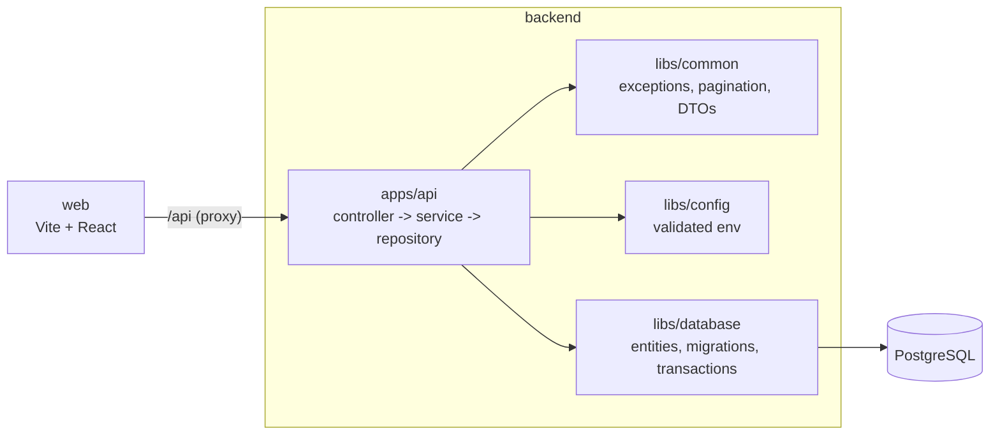
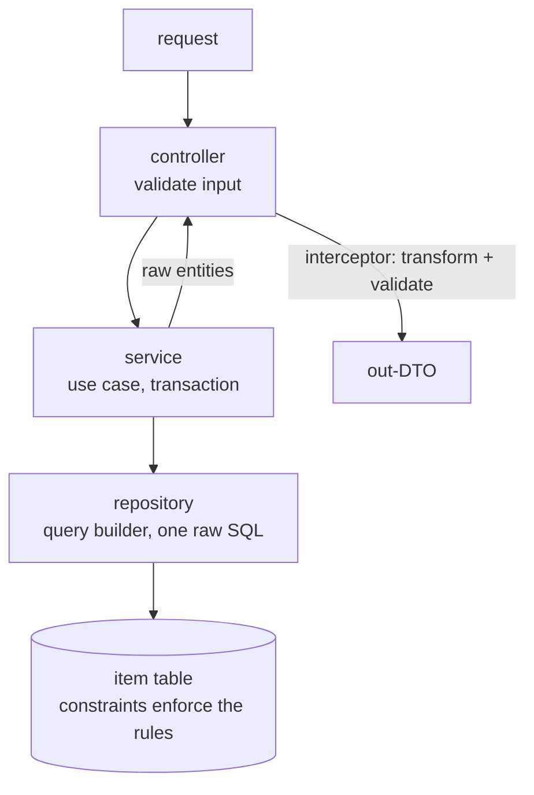

# treefs

File tree metadata service: create folders and files, browse, search by exact name, typeahead by prefix, delete
a whole subtree. Metadata only, no file contents.

- **API:** NestJS, REST under `/api`
- **Web:** Vite, React, TanStack Query
- **Store:** PostgreSQL is the source of truth
- **Scope:** time-boxed take-home. Every feature is built; the expensive proof is cut and listed in
  [Trade-offs](#trade-offs-and-what-i-skipped)

## Architecture



| Path               | Role                                                      |
| ------------------ | --------------------------------------------------------- |
| `backend/apps/api` | HTTP API, one module per domain (`items`)                 |
| `backend/libs/*`   | `common`, `config`, `database`, `dto`                     |
| `web`              | single-page app, API types generated at build time        |
| repo root          | Prettier, commitlint, husky, knip, shared tsconfig/ESLint |

## Run it

Needs Node 24.2+, pnpm (corepack) and Docker for Postgres.

```sh
corepack enable
pnpm install
cp backend/apps/api/.env.example backend/apps/api/.env
cp backend/apps/api/.env.test.example backend/apps/api/.env.test
pnpm services      # Postgres via docker compose
pnpm db:migrate
pnpm start:dev     # API  :3001
pnpm dev:web       # web  :3000, proxies /api
```

- **One command:** `docker compose up --build` builds the API and web images, starts Postgres, migrates on API
  start and serves the app on http://localhost:3000 (nginx forwards `/api` to the API)
- **Debug:** `pnpm start:debug` (inspector on 9229), then "Attach to API" in `.vscode/launch.json`
- **Production build:** `pnpm build` -> `node backend/dist/apps/api/main.js`; `pnpm --filter web build` -> `web/dist`
- **Dev container:** set `DB_HOST=host.docker.internal` in both `.env` files
- **Config:** no defaults in code; a missing or bad variable stops startup

## Checks and tests

| Command         | Runs                                                                    |
| --------------- | ----------------------------------------------------------------------- |
| `pnpm check`    | prettier, eslint, typecheck, knip, all tests                            |
| `pnpm test`     | unit tests (`*.spec.ts`), pure functions only                           |
| `pnpm test:e2e` | integration tests (`*.e2e-spec.ts`), real app over HTTP + real Postgres |

- **No mocks in the data path:** a mock cannot enforce a unique index
- **Covered:** every status code, 50-way race on one name (one 201), create racing delete of its parent,
  parallel deletes, cursor paging, 64-level paths, adversarial names
- **Isolation:** each suite declares its tables and truncates them; helpers refuse a database not ending in `_test`
- **Hooks:** pre-commit (prettier, eslint), commit-msg (commitlint), pre-push (`pnpm check`)
- **Web:** no tests

## API

| Request                                                              | Success                            | Errors                                                         |
| -------------------------------------------------------------------- | ---------------------------------- | -------------------------------------------------------------- |
| `POST /api/v1/items` `{type, name, parentId\|null}`                  | 201 + `Location`                   | 400 · 404 parent · 409 name · 422 parent is a file or too deep |
| `GET /api/v1/items/{id}`                                             | 200 item + `path`, `ancestors`     | 400 · 404                                                      |
| `GET /api/v1/items?parentId=root\|{id}&type&limit&cursor`            | 200 `{items, nextCursor}`, by name | 400 · 404 · 422 not a folder                                   |
| `GET /api/v1/items?q&match=exact\|prefix&type&parentId&limit&cursor` | 200 `{items, nextCursor}`          | 400                                                            |
| `DELETE /api/v1/items/{id}`                                          | 204, no body, deletes the subtree  | 400 · 404                                                      |

- **Error body:** `{code, message, statusCode, correlationId, errors?}`, `code` is `<category>.<status>`
  (`conflict.nameTaken`); `x-request-id` carries the correlation id
- **Exact search:** with `parentId` the folder's direct children, without it every folder
- **Prefix search (typeahead):** top 10, newest first, empty `q` lists the newest items

## Design



- **The database enforces the rules.** Insert first, map the SQLSTATE; never check-then-insert
  - unique `lower(normalize(name, NFC))` per folder, top level included (`NULLS NOT DISTINCT` index)
  - parent must be a folder, name ≤ 255 bytes, depth ≤ 64 (a folder at depth 64 may exist and stays empty)
  - `ON DELETE CASCADE` removes a subtree in one `DELETE`
- **Every read is an index range with a LIMIT:** keyset paging, prefix search as a range (no `LIKE`)
- **Paths are computed at read time** by one recursive query per page; nothing stored can go stale
- **Types flow one way:** `src/types.ts` names every endpoint's body, params and response; the web app
  gets them generated and never imports a schema
- **Migrations** are generated from the entities (`pnpm --filter backend migration:generate`) and run on demand
  with `pnpm db:migrate`

## Trade-offs and what I skipped

- **Typeahead worst case:** newest-first is not index-ordered; a prefix with thousands of old matches walks the
  primary key (~100 ms at 10^6 rows). Next: cap candidates by name, or a search index
- **Load testing:** no k6 at 10^5 to 10^7 rows; EXPLAIN shows index ranges with a LIMIT. Next: chart p95 vs size
- **Failure tests:** no forced serialization failures, connection kills mid-delete, SIGTERM under load.
  Constraints and single-statement writes make them hold by construction
- **Idempotent retries:** a create retried after a timeout may return 409. Next: `Idempotency-Key` stored in the
  insert's transaction
- **Large deletes are synchronous:** one transaction locks the subtree; a huge folder hits the statement timeout
  and returns 500. Next: soft delete plus background purge
- **Database outage:** answers 500, there is no 503 mapping or `Retry-After`
- **Web trusts the API:** types are generated, responses are not validated at runtime
- **Left out:** health checks, rate limits, helmet, CORS allowlist, body limit, separate DB roles, CSP
- **Delivery:** no CI job (the pre-push hook runs `pnpm check`); the Dockerfiles are basic, with no layer-caching tricks
- **Tests:** no property-based or Playwright tests; integration files run serially on one test database
- **Out of scope:** auth, sharing, rename/move, file contents, visit-based suggestions, fuzzy search

## Scaling

PgBouncer and read replicas -> soft delete with batched purge -> shard by `parent_id` (siblings stay together, so
unique names still hold) -> search index fed from Postgres for typeahead.

## AI usage

Claude Code wrote much of the code and tests in small reviewed commits; design decisions, trade-offs and cuts are
mine. `backend/AGENTS.md` (Nest CLI) and `CLAUDE.md` hold the rules the code follows.
